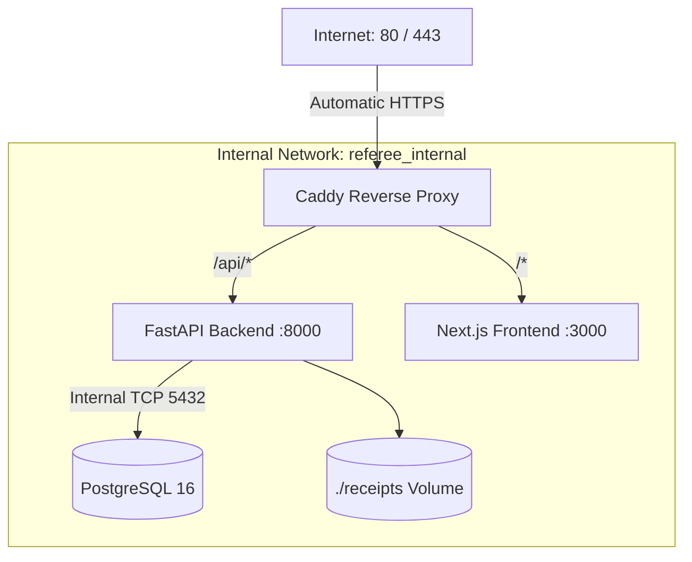

# Production Deployment Guide: Referee Manager

**Target Environment**: Hostinger VPS, Ubuntu 24.04 LTS  
**Domains**: `admin.draarbitre.com` (Admin & App Portal) and `draarbitre.com`  
**Architecture**: Single origin via Caddy (automatic HTTPS), routing `/api/*` to FastAPI backend and everything else to Next.js frontend, backed by PostgreSQL 16.

---

## 1. Quick Reference: The 5 Deployment Commands

On a clean Ubuntu 24.04 LTS VPS with DNS A record pointing to the server IP:

```bash
# 1. Update system and install Docker CE & Docker Compose
curl -fsSL https://get.docker.com | sh && sudo usermod -aG docker $USER && newgrp docker

# 2. Clone the repository
git clone <YOUR_GIT_REPOSITORY_URL> /opt/referee-app && cd /opt/referee-app

# 3. Generate secure production environment (saves .env with chmod 600)
bash scripts/gen-env.sh admin.draarbitre.com admin@draarbitre.com

# 4. Deploy the production stack (builds non-root images, starts containers, verifies health)
bash scripts/deploy.sh

# 5. Configure automated daily backups (runs at 03:00 daily, retains 14 days)
(crontab -l 2>/dev/null; echo "0 3 * * * cd /opt/referee-app && bash scripts/backup.sh >> /var/log/referee-backup.log 2>&1") | crontab -
```

---

## 2. Server Preparation & Hardening (Ubuntu 24.04 LTS)

### A. System Packages & Firewall (`ufw`)
Ensure only SSH (22), HTTP (80), and HTTPS (443) are exposed to the public internet:

```bash
sudo apt update && sudo apt upgrade -y
sudo apt install -y ufw fail2ban curl git jq

# Configure firewall
sudo ufw default deny incoming
sudo ufw default allow outgoing
sudo ufw allow 22/tcp comment "SSH"
sudo ufw allow 80/tcp comment "HTTP (Caddy Let's Encrypt)"
sudo ufw allow 443/tcp comment "HTTPS (Caddy)"
sudo ufw --force enable
sudo ufw status verbose
```

### B. Fail2ban Setup
Protect SSH against brute-force login attacks:

```bash
sudo systemctl enable --now fail2ban
sudo systemctl status fail2ban
```

---

## 3. Production Environment Generation (`scripts/gen-env.sh`)

The script `scripts/gen-env.sh` automatically generates cryptographically strong random credentials using `openssl rand -hex` and creates the `.env` file with `chmod 600` permissions.

```bash
bash scripts/gen-env.sh admin.draarbitre.com admin@draarbitre.com
```

### Generated Parameters in `.env`
- `DOMAIN`: Domain name served by Caddy (`admin.draarbitre.com`).
- `ENV`: Set to `production` (enforces strict security guards, disables API swagger docs, hides internal error stack traces).
- `POSTGRES_USER`: Dedicated database user (`referee_app`).
- `POSTGRES_PASSWORD`: 32-character random database password.
- `POSTGRES_DB`: `referee_db`.
- `DATABASE_URL`: Internal connection string `postgresql://referee_app:<PASS>@db:5432/referee_db`.
- `JWT_SECRET`: 64-character random hex secret (HS256).
- `JWT_EXPIRE_MINUTES`: `720` (12 hours).
- `ADMIN_EMAIL`: Initial admin login email.
- `ADMIN_PASSWORD`: 24-character random password (displayed **once** upon generation).
- `ADMIN_NAME`: `Administrateur`.

> [!IMPORTANT]
> The generated administrator credentials are printed to stdout **only once** when running `scripts/gen-env.sh`. Note them securely in your password manager.

---

## 4. Production Deployment (`scripts/deploy.sh`)

The deployment script executes the complete build and start cycle:
1. Validates that `.env` exists and contains production parameters.
2. Creates the `./receipts` storage directory with correct write permissions.
3. Builds the non-root multi-stage Docker images (`backend` and `frontend`).
4. Launches the stack using `docker-compose.prod.yml`.
5. Waits for services to become healthy.
6. Executes a smoke test on `http://127.0.0.1/api/health` through Caddy.

```bash
bash scripts/deploy.sh
```

To view real-time container status:
```bash
docker compose -f docker-compose.prod.yml ps
```

---

## 5. Production Stack Architecture (`docker-compose.prod.yml`)

The production stack consists of four isolated services communicating across an internal bridge network (`referee_internal`):



- **`caddy`**: The only container publishing ports `80` and `443`. Automatically obtains and renews Let's Encrypt TLS certificates. Injects strict security headers (`HSTS`, `CSP`, `X-Frame-Options: DENY`, `no-store` on `/api/*`).
- **`frontend`**: Next.js 16 standalone output running as unprivileged user `nextjs` (UID 1001).
- **`backend`**: FastAPI application running as unprivileged user `appuser` (UID 1001) under Uvicorn with 2 worker processes and `--proxy-headers`.
- **`db`**: PostgreSQL 16 Alpine with data stored in named volume `pgdata_prod`. Port 5432 is **never** published to the host or internet.

---

## 6. Emergency Admin CLI Commands

If you ever need to reset the admin password or create an additional administrator directly on the server without UI access, use the emergency CLI tools:

### Reset Administrator Password
Prompts for a new password (min 12 characters, strong checks), updates `password_changed_at`, and invalidates all existing sessions:

```bash
docker compose -f docker-compose.prod.yml exec backend python -m app.cli reset-admin-password
```

### Create a Second Administrator Account
Creates a new administrator user with email, name, and strong password:

```bash
docker compose -f docker-compose.prod.yml exec backend python -m app.cli create-admin
```

---

## 7. Backups and Disaster Recovery

### Manual Backup
Generates a gzipped PostgreSQL dump and a tarball of all generated PDF receipts in `./backups`:

```bash
bash scripts/backup.sh
```

### Restore from Backup
To restore the database and receipts after an incident or migration:

```bash
# 1. List available backup timestamps
ls -l backups/

# 2. Run restore (requires typing 'RESTORE' to prevent accidental execution)
bash scripts/restore.sh <YYYYMMDD_HHMMSS>
```

Example:
```bash
bash scripts/restore.sh 20261119_030000
```

---

## 8. Verification & Troubleshooting

### Check Service Health & Logs
```bash
# View aggregated live logs
docker compose -f docker-compose.prod.yml logs -f

# Inspect specific container logs
docker compose -f docker-compose.prod.yml logs -f caddy
docker compose -f docker-compose.prod.yml logs -f backend
docker compose -f docker-compose.prod.yml logs -f frontend
docker compose -f docker-compose.prod.yml logs -f db
```

### Verify SSL / Caddy Status
```bash
curl -I https://admin.draarbitre.com/api/health
```
Expected response:
```http
HTTP/2 200
content-type: application/json
strict-transport-security: max-age=31536000; includeSubDomains
x-content-type-options: nosniff
x-frame-options: DENY
cache-control: no-store
```

### Update / Redeploy Application Code
When deploying new changes from Git:
```bash
git pull origin main
bash scripts/deploy.sh
```
